  

 

  
  
  
  
  
  
  
  
  

 

## Featured projects

### Sumukh ERP
A web ERP for a nursing services company, built with JavaScript, Firebase and Netlify.

- Role-based access control (RBAC)
- Animated dashboards with dark mode
- Employee PDF generation
- Finance module

[Repo](#) | [Live demo](#)

### Task Manager API (coming soon)
My first full-stack project with my own backend: Node.js, Express, PostgreSQL, JWT login, deployed live.

## Experience

**Data Analyst Intern**: built dashboards and reports with Power BI, DAX, Python and SQL.

## Contact

[LinkedIn](#) | [Email](mailto:you@example.com) | [Portfolio](#)
